# Laporan Praktikum 6: JavaScript DOM dan Event Handling

| | |
|---|---|
| **Nama** | Naysila Rahil Maulana |
| **NIM** | 312510143 |
| **Mata Kuliah** | Pemrograman Web |
| **Program Studi** | Teknik Informatika, Universitas Pelita Bangsa |
| **Pertemuan** | 7 |
| **Topik** | JavaScript DOM dan Event Handling |

---

## 1. Tujuan Praktikum

1. Memahami DOM sebagai representasi dokumen HTML yang dapat diakses melalui JavaScript.
2. Menggunakan `id`, `class`, dan selector CSS untuk memilih elemen HTML.
3. Mengubah teks, atribut, kelas CSS, dan gaya elemen melalui JavaScript.
4. Menangani event pengguna menggunakan `addEventListener()`.
5. Membuat validasi form dan menampilkan pesan sesuai kondisi input.
6. Mengembangkan halaman interaktif dengan minimal tiga fungsi yang berjalan benar.

---

| Folder / File | Keterangan |
|---|---|
| `mini_project/` | Mini project Form Pendaftaran Workshop |
| `screenshot/` | Bukti hasil pengujian setiap latihan |
| `index.html` | Struktur halaman |
| `style.css` | Tampilan halaman |
| `script.js` | Logika JavaScript (DOM dan event) |

---

## 2. Cara Menjalankan

1. Clone atau unduh repository ini.
2. Buka folder `latihan/` (atau `mini_project/`).
3. Klik dua kali `index.html` sehingga terbuka di browser (Chrome, Edge, atau Firefox).
4. Tekan **F12** lalu buka tab **Console** untuk melihat apakah ada error.

Tidak perlu instalasi tambahan karena hanya memakai HTML, CSS, dan JavaScript murni.

---

## 3. Langkah Kerja

### Persiapan

Membuat folder kerja `lab6_dom_event` berisi `index.html`, `style.css`, dan `script.js`. File CSS dan JavaScript dihubungkan dari `index.html`. JavaScript dipanggil dengan atribut `defer` agar dijalankan setelah HTML selesai diparsing, sehingga elemen yang dipilih sudah tersedia.

---

### Latihan 1: Mengubah Teks dengan DOM

**Tujuan:** memilih elemen berdasarkan `id` lalu mengubah isinya.

**Langkah:**
1. Memilih elemen `judul` dan `pesan` dengan `document.getElementById()`.
2. Mengubah isinya dengan properti `textContent`.
3. Mengganti kalimat pesan dengan kalimat lain dan mengamati hasilnya.

**Hasil:** judul berubah menjadi "Belajar JavaScript DOM" dan paragraf berubah sesuai kalimat yang diisi lewat JavaScript.

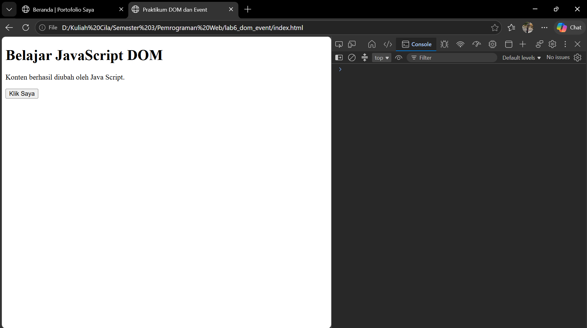

---

### Latihan 2: Event Click

**Tujuan:** menampilkan waktu saat tombol diklik.

**Langkah:**
1. Memilih tombol `tombolAksi`.
2. Menambahkan `addEventListener("click", ...)`.
3. Di dalam fungsi, mengubah isi paragraf dengan waktu dari `new Date().toLocaleTimeString()`.

**Hasil:** setiap tombol diklik, paragraf menampilkan jam saat klik dilakukan, dan jamnya berubah di setiap klik.

| Klik pertama | Klik kedua |
|---|---|
| 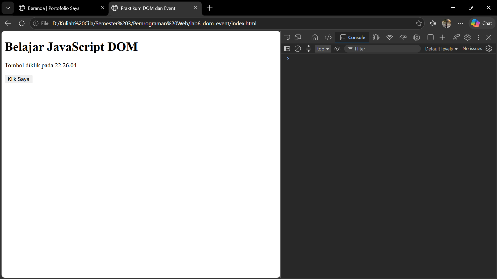 |  |

---

### Latihan 3: Mengubah Kelas dan Gaya CSS

**Tujuan:** mengubah tampilan elemen dengan menambah atau menghapus kelas CSS.

**Langkah:**
1. Membuat kelas `.highlight` dan `.teks-besar` di `style.css`.
2. Membuat paragraf `teksGaya` dan tombol `tombolGaya`.
3. Memakai `classList.toggle()` pada klik tombol.

**Hasil:** saat tombol diklik, teks menjadi biru, besar, dan bergaris kiri. Saat diklik lagi, teks kembali normal.

| Sebelum | Sesudah klik | Klik lagi |
|---|---|---|
|  | 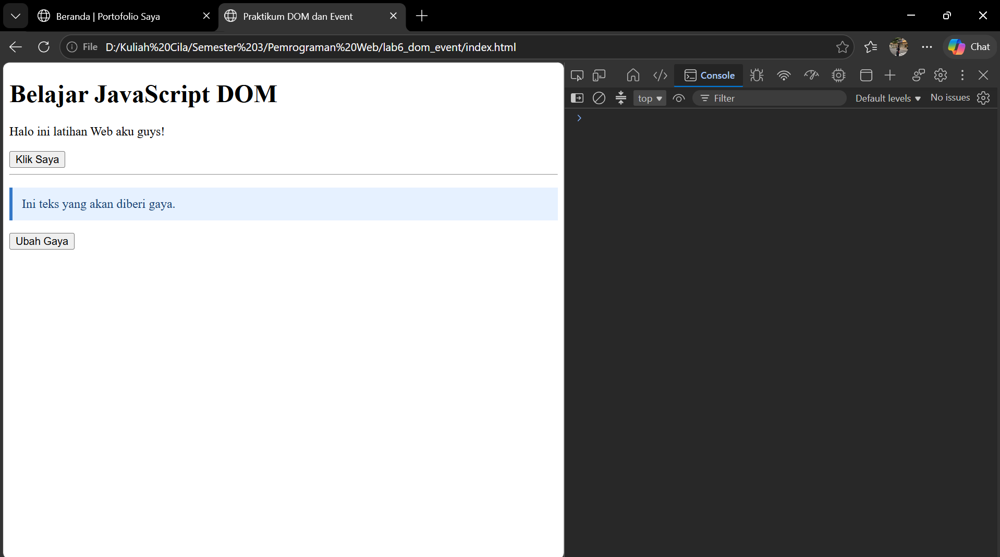 |  |

**Pengamatan perbedaan `add`, `remove`, dan `toggle`:**

| Method | Perilaku |
|---|---|
| `classList.add("x")` | Menambahkan kelas `x`. Jika sudah ada, tidak terjadi perubahan |
| `classList.remove("x")` | Menghapus kelas `x`. Jika tidak ada, tidak terjadi apa-apa |
| `classList.toggle("x")` | Menambahkan kelas jika belum ada, menghapusnya jika sudah ada |

Hasil percobaan memakai `add` (teks tetap berbaju walau diklik berkali-kali):

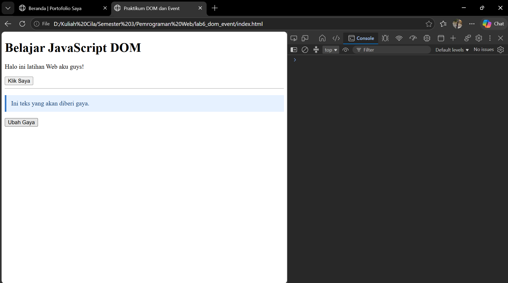

---

### Latihan 4: Event Input dan Penghitung Karakter

**Tujuan:** memperbarui jumlah karakter secara langsung saat pengguna mengetik.

**Langkah:**
1. Membuat input teks `namaInput` dengan `maxlength="40"` dan elemen `span` untuk angka.
2. Menambahkan listener event `input`.
3. Menampilkan `namaInput.value.length` pada `span`.

**Hasil:** angka berubah saat mengetik, menghapus, maupun menempel (paste) teks, dan berhenti di 40 karakter.

| Awal | Mengetik |
|---|---|
|  |  |

| Menghapus | Paste teks panjang |
|---|---|
|  |  |

---

### Latihan 5: Validasi Form Pendaftaran

**Tujuan:** memeriksa input form sebelum diproses dan menampilkan pesan sesuai kondisi.

**Langkah:**
1. Membuat form dengan field nama, email, dan usia, memakai atribut `novalidate`.
2. Memakai event `submit` dan `event.preventDefault()` agar halaman tidak dimuat ulang.
3. Membersihkan input dengan `trim()`, lalu memeriksa kondisi secara berurutan dengan `if / else if / else`.
4. Menambahkan syarat nama minimal 3 karakter (Eksperimen 2 sudah diterapkan pada kode ini).

**Skenario pengujian:**

| # | Kondisi | Pesan yang muncul |
|---|---|---|
| 1 | Semua kosong | Nama wajib diisi. |
| 2 | Nama kosong, lainnya valid | Nama wajib diisi. |
| 3 | Email tidak valid | Masukan email yang valid. |
| 4 | Usia di bawah 17 | Usia harus berupa bilangan bulat 17-100. |
| 5 | Semua input valid | Validasi berhasil. Form siap diproses. |

**Kondisi 1: semua kosong**

**Kondisi 2: nama kosong**

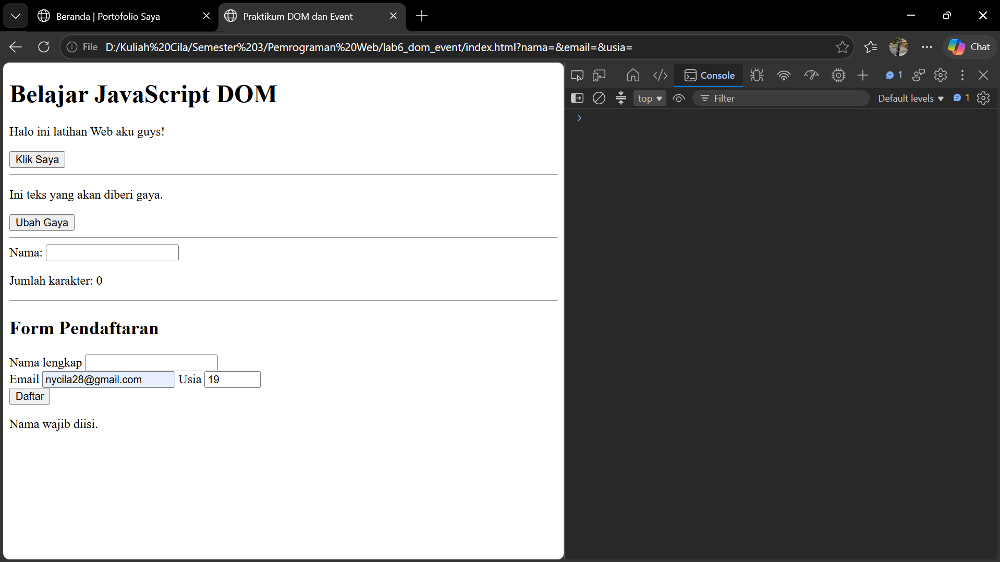

**Kondisi 3: email tidak valid**

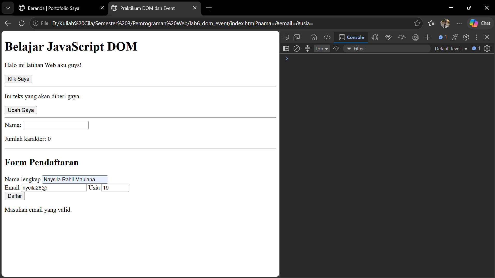

**Kondisi 4: usia di bawah 17**

**Kondisi 5: semua input valid**

Setelah tombol Daftar ditekan:

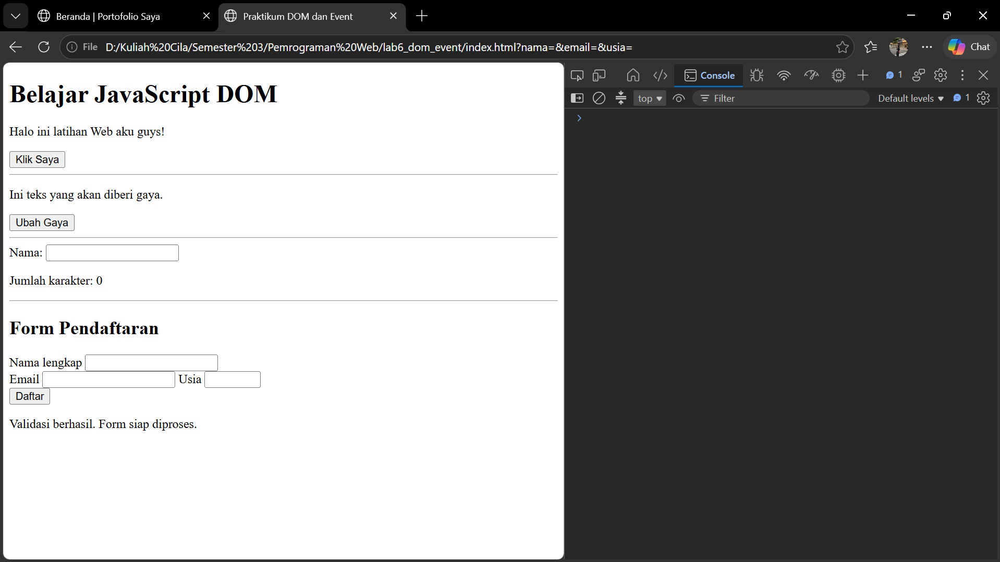

---

### Latihan 6: Daftar Tugas (To-do List)

**Tujuan:** membuat elemen baru secara dinamis dan menandai tugas selesai.

**Langkah:**
1. Membuat input tugas, tombol Tambah, pesan, dan daftar `ul`.
2. Saat tombol Tambah diklik, teks input diambil dan diperiksa tidak kosong.
3. Membuat elemen `li`, `span`, dan `button` memakai `document.createElement()`.
4. Menambahkan listener pada tombol "Tandai selesai" yang melakukan `classList.toggle("selesai")`.
5. Memasukkan elemen ke daftar dengan `append()` dan `appendChild()`.
6. Mengosongkan input dan memindahkan fokus kembali ke input.
7. Menambahkan tombol "Hapus" untuk menghapus satu item (Eksperimen 1 sudah diterapkan pada kode ini).

**Hasil:**

| Input kosong | Menambah tugas |
|---|---|
| 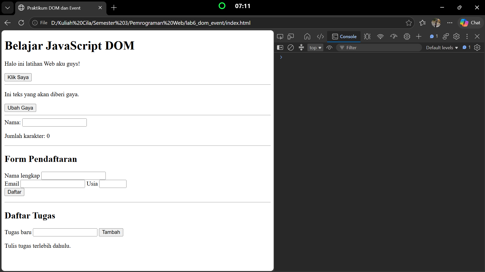 | 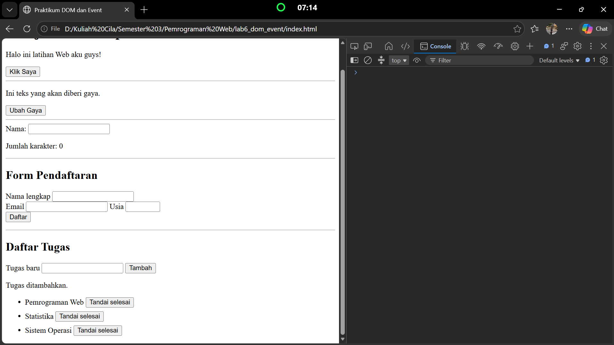 |

| Tandai selesai |
|---|---|
|  | 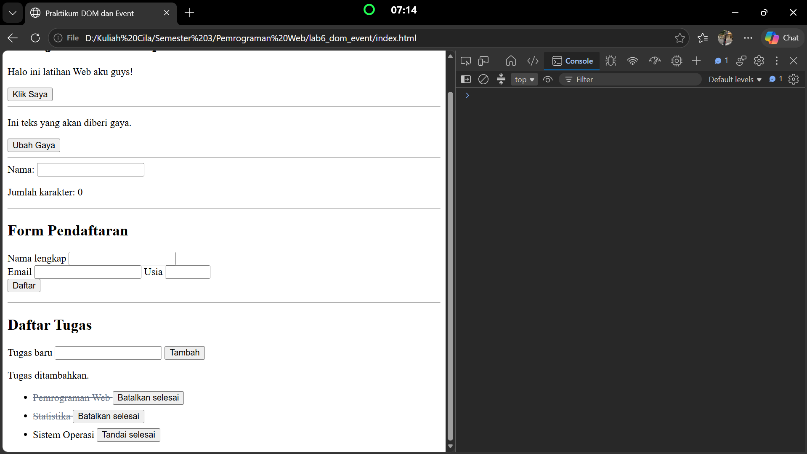 |

---

## 5. Mini Project: Form Pendaftaran Workshop

Halaman pendaftaran workshop yang dipisah ke `index.html`, `style.css`, dan `script.js` di folder `mini_project/`, dengan tampilan responsif untuk desktop dan mobile.

**Fitur interaktif:**

| Fitur | Event yang dipakai |
|---|---|
| Penghitung karakter nama dan ringkasan input secara langsung | `input` |
| Menampilkan sesi yang dipilih pada ringkasan | `change` |
| Validasi nama, email, dan pilihan sesi, dengan pesan error (merah) dan sukses (hijau) | `submit` |
| Tombol reset untuk mengosongkan form dan ringkasan | `click` |

**Hasil pengujian:**

| Tampilan awal | 
|---|---|
| 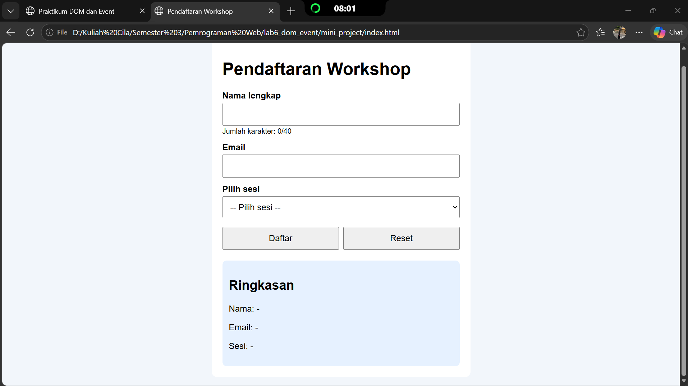 |  

| Pesan error | Pesan sukses |
|---|---|
| 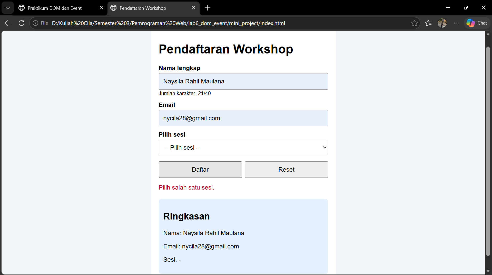 | 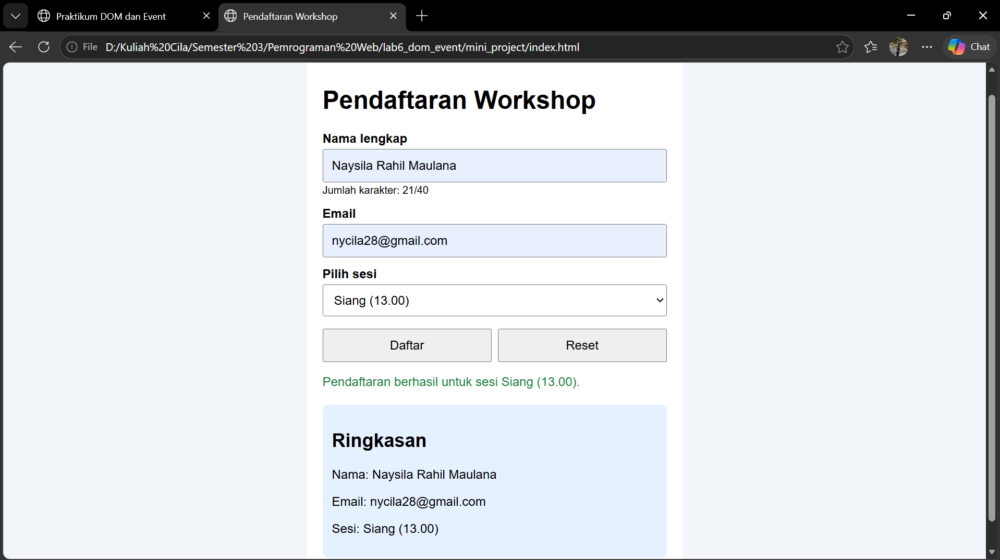 |

| Setelah reset | Tampilan mobile |
|---|---|
| 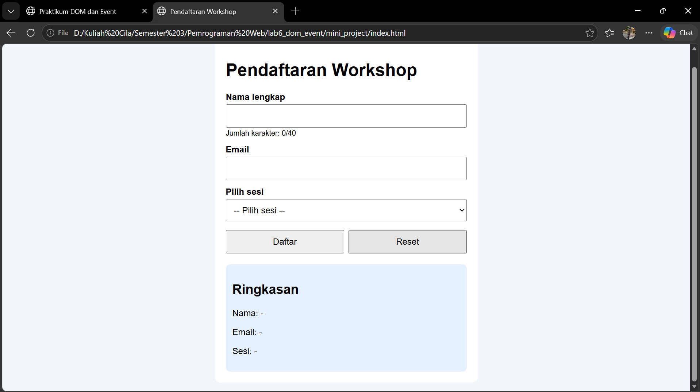 | 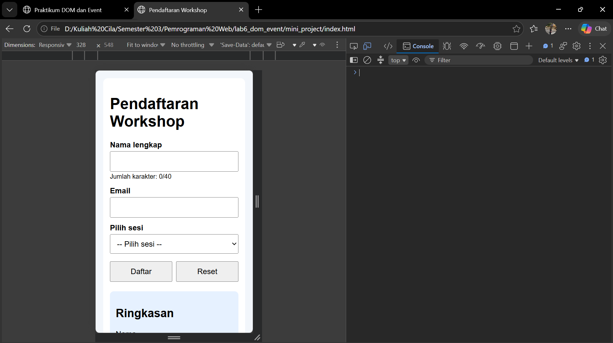 |

---

## 6. Eksperimen Mandiri

### Eksperimen 1: Tombol hapus pada To-do List

Menambahkan tombol "Hapus" pada setiap item. Tombol dibuat dengan `createElement("button")`, lalu diberi listener yang menjalankan `item.remove()`.

| Sebelum dihapus | Sesudah dihapus |
|---|---|
| 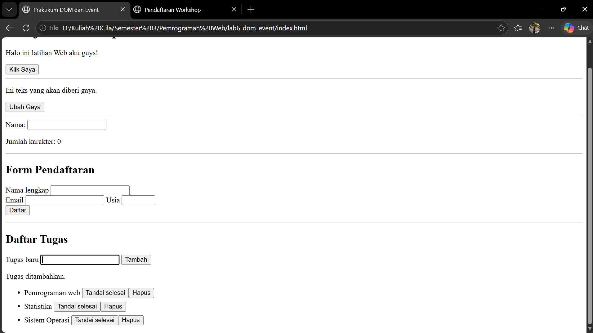 | 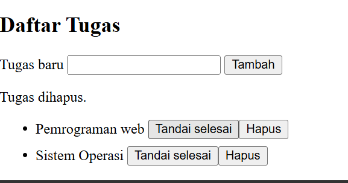 |

### Eksperimen 2: Nama minimal 3 karakter

Menambahkan pemeriksaan `nama.length < 3` setelah pemeriksaan nama kosong, dengan pesan "Nama minimal 3 karakter."

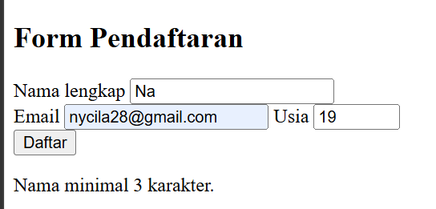

### Eksperimen 3: Event `change` pada dropdown sesi workshop

Menambahkan listener `change` pada elemen `select`. Saat pilihan berganti, sesi yang dipilih ditampilkan pada paragraf `infoSesi`.

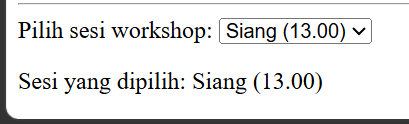

### Eksperimen 4: Menyembunyikan dan menampilkan paragraf

Membuat kelas CSS `.sembunyi { display: none; }`, lalu tombol memakai `classList.toggle("sembunyi")` pada paragraf.

| Paragraf disembunyikan | Paragraf ditampilkan |
|---|---|
| 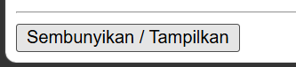 | 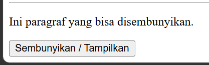 |

### Eksperimen 5: Script tanpa `defer` di bagian `<head>`

Atribut `defer` dihapus dari tag `<script>` pada salinan project, lalu halaman dibuka dengan Console terbuka.

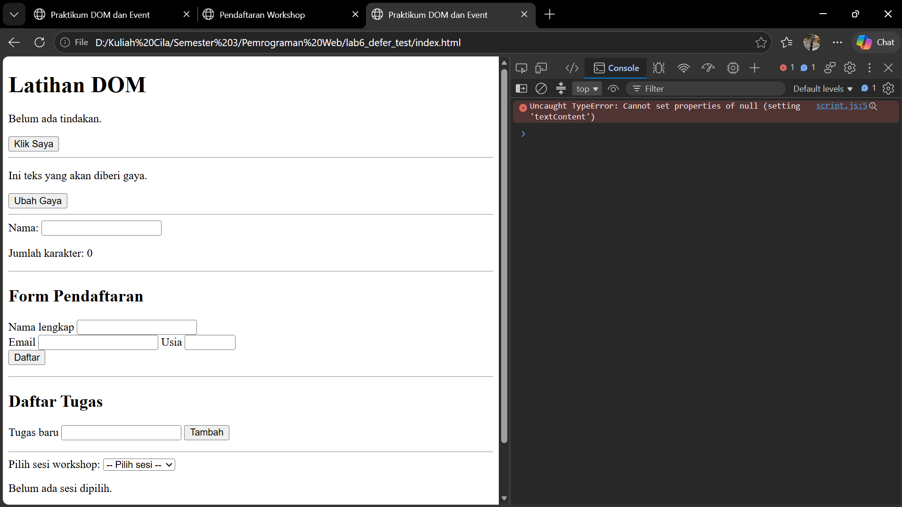

**Pengamatan:** muncul error `Cannot read properties of null` dan perubahan teks tidak terjadi.

**Penyebab:** browser membaca HTML dari atas ke bawah. Script di `<head>` berjalan sebelum `<body>` selesai dibaca, sehingga saat itu elemen seperti `<h1 id="judul">` belum ada. Akibatnya `document.getElementById("judul")` menghasilkan `null`, dan mengakses `textContent` dari `null` menyebabkan error. Dengan `defer`, script ditunda sampai seluruh HTML selesai diparsing, sehingga semua elemen sudah tersedia.

---

## 8. Kesimpulan

Dalam praktikum ini, JavaScript digunakan untuk memilih elemen HTML melalui DOM, mengubah teks, kelas, dan gaya elemen, serta merespons tindakan pengguna lewat `addEventListener()`. Validasi form dengan `preventDefault()` dan pemeriksaan berurutan menghasilkan pesan yang sesuai dengan kondisi input. Mini project menggabungkan event `input`, `change`, `click`, dan `submit` menjadi halaman pendaftaran yang interaktif dan responsif. Dari eksperimen `defer`, terlihat bahwa urutan eksekusi script sangat memengaruhi keberhasilan pemilihan elemen.

---

